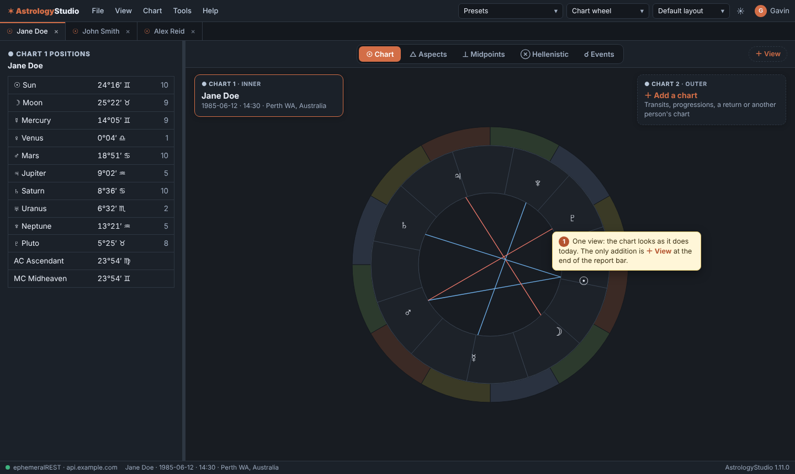
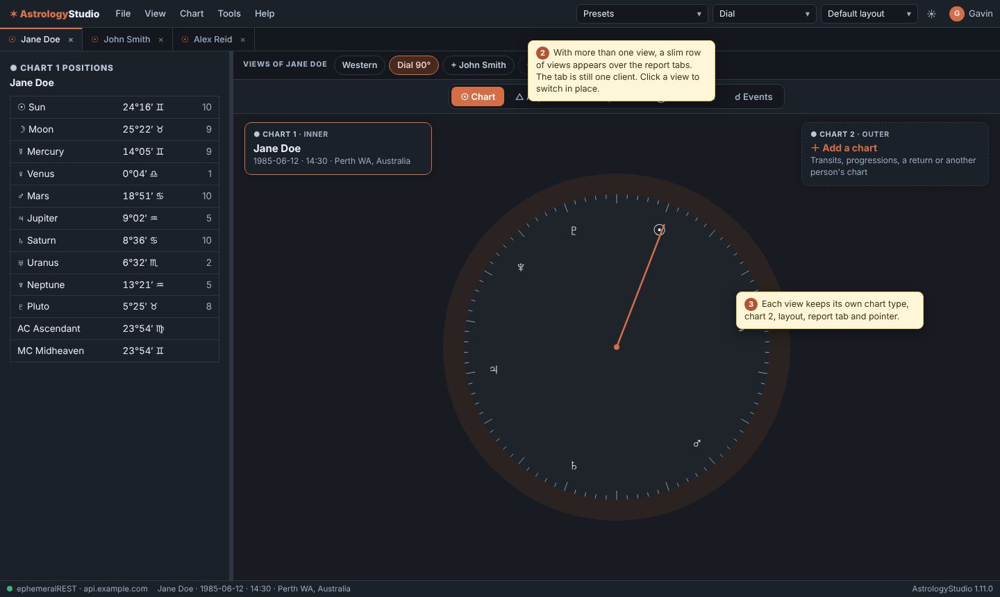
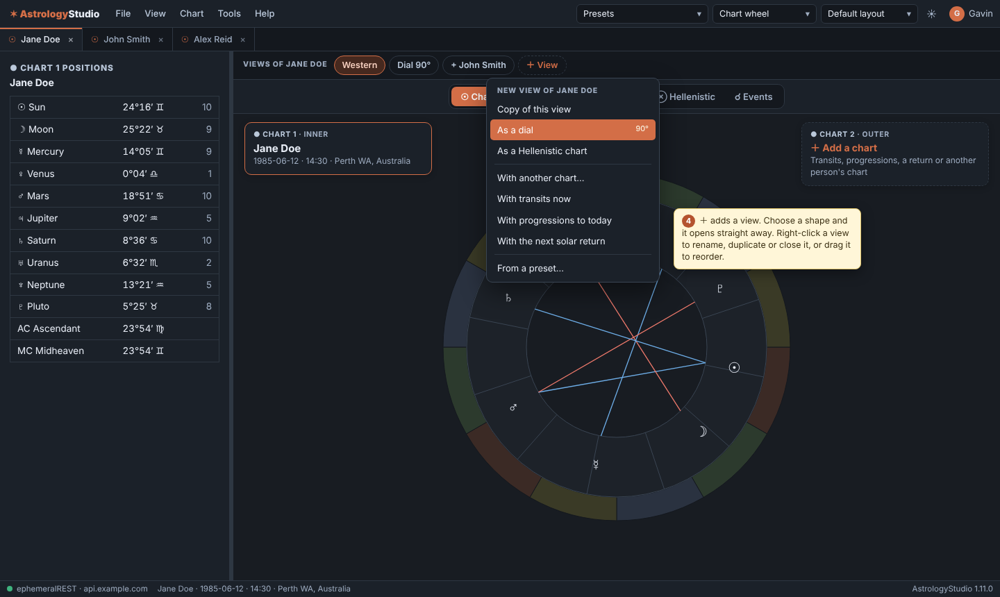
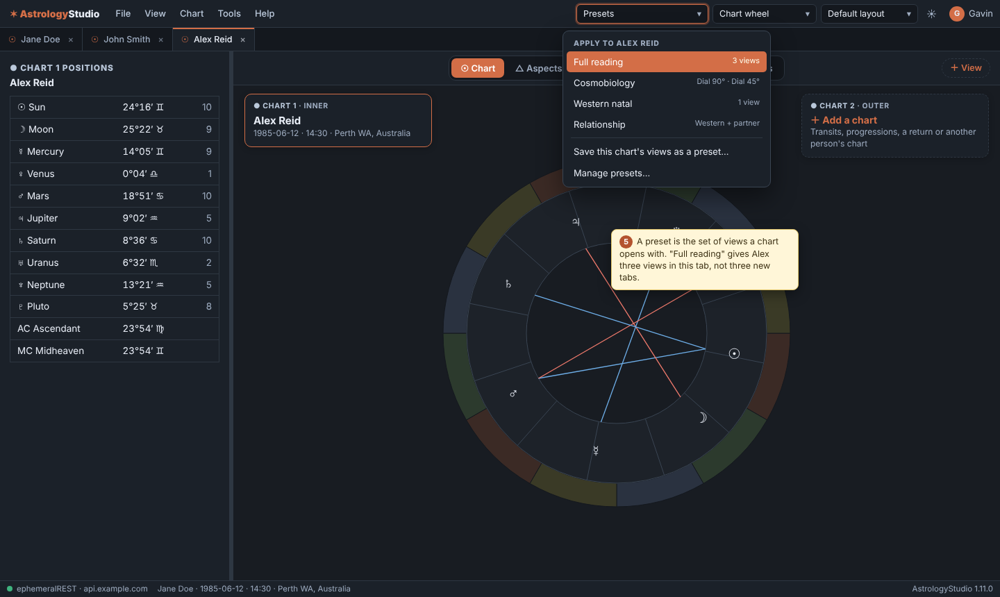
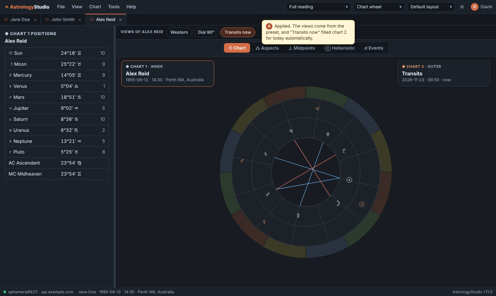
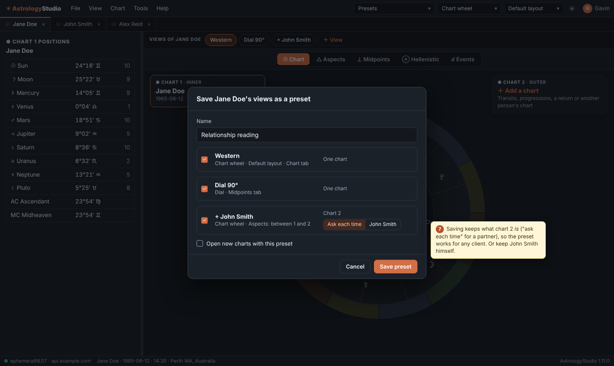
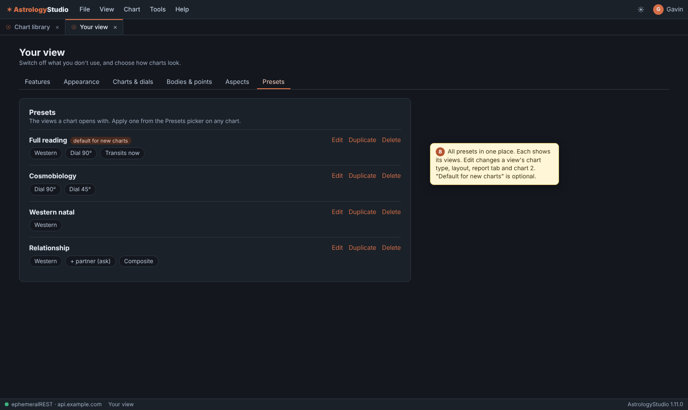

# AstrologyStudio: views inside a chart, and presets as sets of views

Design and iteration plan. **Status:** agreed 23 Nov 2026, and **built in 1.11–1.13**. Written
against 1.10.1; the screens are the mock-ups it was agreed from. This replaces the first draft (views as separate tabs), which would have been too
much to manage.

Sample screens are in `screens/`. They're mock-ups: the layout and wording are meant, the drawing
is not.

## 1. The idea in one paragraph

**Tabs stay one per client.** A chart's tab can now hold several **views**: ways of looking at
the same chart, such as *Western*, *Dial 90°*, and *+ John Smith*. With more than one view, a
slim row above the report tabs lists them. Click one to switch in place. A **preset** becomes the
**set of views a chart opens with**: apply "Full reading" and the chart gets its three views in
the same tab. With one view, nothing on screen changes from today apart from a small **＋ View**
button.

## 2. Why this shape

- **Most people work on one chart at a time.** They should see no extra steps or clutter. With one
  view the screen is exactly as now.
- **Tabs mean "who I'm working on".** Three clients means three tabs, however many views each has,
  so the tab strip doesn't fill up with *Jane Doe · Dial 90°*-style labels.
- **People who work in a set routine get it in one click.** A consultant who always looks at a
  natal wheel, a dial and transits makes that a preset (and, if they like, the default for new
  charts).

## 3. Sample screens

### 3.1 One view: as today



A chart with one view looks exactly as it does now. The only addition is **＋ View** at the right
end of the report bar.

### 3.2 Several views in one tab



With two or more views, a slim **views row** appears above the report tabs: *Views of Jane Doe:
Western · Dial 90° · + John Smith · ＋ View*. Clicking a view switches the canvas in place.

Each view keeps its own:
- chart type and dial size
- layout
- chart 2
- report tab
- selected chart
- *Between 1 and 2*
- dial pointer

So going back to *Dial 90°* finds the pointer where you left it.

The title bar's Chart type, Dial size and Layout pickers change **this view** only.

### 3.3 Adding a view



**＋ View** offers the usual shapes:
- a copy of this view
- as a dial (in your default size)
- as a Hellenistic chart
- with another chart…
- with transits now
- with progressions to today
- with the next solar return
- from a preset…

The new view opens straight away and can be adjusted with the normal pickers. Right-clicking a
view lets you rename, duplicate or close it, and views can be dragged to reorder them. Closing the
last but one view hides the row again.

### 3.4 Applying a preset



The **Presets** picker in the title bar applies a preset to the chart in this tab:

- **One-view preset**: changes the current view. This is today's behaviour, but for this tab only.
- **Several views**: the chart's views become the preset's views. If the chart already has views
  you've changed, it asks the first time whether to replace them or add the preset's views after
  them, with *Remember my choice* (see 10).



Chart 2 in a preset is a **role**, not a fixed chart. "Transits now" fills itself for the current
moment, so the views are ready without any dialogs. For "a partner (ask each time)", the chart
dialog opens on that view so you can pick one.

### 3.5 Saving views as a preset



**Save this chart's views as a preset…** (Presets picker, or the Chart menu) lists the chart's
views, ticked, so any can be left out. For each view with a chart 2 you choose:

- **Ask each time** (or the matching role: transits now, progressions to today and so on). This is
  the default, and it's what makes the preset work for any client.
- **This exact chart**, e.g. always compare with John Smith, or with a mundane chart.

*Open new charts with this preset* makes it the default (see 6.3).

### 3.6 Presets in My View



Presets move from Charts & dials to their own **Presets** tab in My View. Each preset shows its
views as chips. You can edit (a view's chart type, dial size, layout, report tab and chart 2 role,
plus the preset's theme and profile), duplicate, delete, reorder and set the default.

## 4. Concepts

| Term | Meaning |
|---|---|
| **Tab** | One chart (chart 1), as now. One per chart. |
| **View** | One way of looking at that chart: chart type, dial size, layout, chart 2, report tab, selected chart, *Between*, pointer, name. |
| **Preset** | A name, an optional theme and profile, and 1–6 **view templates** (a view whose chart 2 is a role). |
| **Default preset** | Optional. Used when a chart is opened that has no views yet. |

What stays global, as now:
- theme (a preset may still switch it, as today)
- calculation profile (a preset may still switch it, as today)
- My View: features, bodies, aspects and their colours, line symbols, leader lines
- text size, formats, and light/dark

**Calculation profile per view is left out.** It's the most server work for the rarest need. It's
noted in 9 as a possible later step.

## 5. Data

### 5.1 Views (kept per chart, server-side)

```ts
interface View {
  id: string;                  // "v_" + random
  name: string | null;         // null: named from its settings ("Dial 90°", "+ John Smith")
  display: 'wheel' | 'hellenistic' | 'dial';
  dial_size: number;
  layout: string | null;       // null: your default layout for that chart type
  partner: SlotRef | null;     // chart 2
  report: 'chart' | 'aspects' | 'midpoints' | 'hellenistic' | 'events';
  selected: 0 | 1;
  between: boolean;
  pointer: number | null;
}

interface ChartViews {         // one per chart that has views
  views: View[];               // 1–6
  active: string;              // id of the view shown
  preset: string | null;       // preset last applied, for the picker's label
}
```

- Stored server-side under a new preference key, **`chart_views`**, a map from chart id to
  `ChartViews`. Views then follow you between devices, like open tabs do now.
- **Limits:** 6 views per chart. The 300 most recently used charts are kept; older ones fall back
  to the default.
- **Endpoints:**
  - `GET /preferences/chart-views/{chart_id}`
  - `PUT /preferences/chart-views/{chart_id}`
  - `DELETE /preferences/chart-views/{chart_id}` (back to the default)
- A chart with no entry gets one view built from your defaults (the last chart type, layout and
  report you used), so everything opened today keeps working unchanged.

### 5.2 Presets v2

```ts
interface Preset {
  id: string;
  name: string;
  theme: string | null;
  profile: string | null;
  views: ViewTemplate[];       // 1–6
}

interface ViewTemplate {
  name: string | null;
  display: 'wheel' | 'hellenistic' | 'dial';
  dial_size: number | null;
  layout: string | null;
  report: Report;
  between: boolean;
  partner: PartnerRole;
}

type PartnerRole =
  | { role: 'none' }
  | { role: 'ask' }                          // the chart dialog opens on this view
  | { role: 'transits_now' }
  | { role: 'progressions_now' }
  | { role: 'solar_arc_now' }
  | { role: 'solar_return_next' }
  | { role: 'lunar_return_next' }
  | { role: 'fixed'; chart: SlotRef };       // a particular saved chart
```

Existing presets become one-view presets. The old `display`, `dial_size` and `layout` fields fill
the template, and `panel` maps to `report` with the existing `reportOf()` rule. Roles that make a
derived chart reuse the Derived dialog's calculations, so no new calculations are needed.

## 6. Behaviour

### 6.1 Opening a chart
- Already has views: they come back as you left them.
- No views: the default preset if you've set one, otherwise one view from your defaults.

### 6.2 Title bar pickers
- Chart type, dial size and layout change the **current view**.
- The Presets picker applies a preset to **this chart** (3.4).
- The values you pick are remembered as the defaults for new views.

### 6.3 Default preset
- None at first: charts open with one view, as now.
- Set from the save dialog or My View → Presets.

### 6.4 Things that keep working as they are
- One tab per chart, the chart cards on the canvas, the report tabs, Ctrl+K and the chart library.
- The address `/charts/{id}` opens the chart's active view. `/charts/{id}?view={viewId}` opens a
  particular view (for the browser's back and forward buttons and the tab's remembered place).

## 7. Server changes

1. The `chart_views` preference key and its endpoints, with validation (layout and profile ids are
   checked and fall back to defaults if they've gone), limits, and pruning of the least-recently
   used.
2. Presets v2 in `clean_preset()`, still reading old presets, and `views` in the preset endpoints.
3. Tests for both, and for migrating presets.

No changes to chart calculations or ephemeralREST.

## 8. Iteration plan

Each iteration ships on its own, with browser and server tests, changelog and user-guide updates.

### 1.11 — Views in a chart
- `chart_views` storage and endpoints. The chart screen reads and writes its active view rather
  than global prefs.
- The views row (two or more views), **＋ View** and its menu (copy, as a dial, Hellenistic, with
  another chart, transits now, progressions, solar return).
- Rename, duplicate, close and reorder views.
- Title bar pickers act on the current view.
- Tests:
  - one chart with a wheel and a dial view
  - each view keeps its pointer, report and chart 2
  - views survive a reload
  - one-view charts look unchanged

### 1.12 — Presets as sets of views
- Presets v2 and migration.
- Applying one-view and multi-view presets, with replace or add (ask the first time, *Remember my
  choice*).
- Partner roles: none, ask, transits now, progressions now, solar arc now, next solar or lunar
  return, and fixed.
- Save this chart's views as a preset. Default preset for new charts.
- Tests:
  - a three-view preset applied to a new chart
  - **ask** opens the chart dialog
  - saving and applying round-trips
  - old presets still apply

### 1.13 — Presets tab in My View
- A Presets tab replaces the presets list in Charts & dials. Edit a preset's views (chart type,
  dial size, layout, report, chart 2 role), theme and profile. Duplicate, delete, reorder, set the
  default.
- Phone layout: the views row scrolls sideways, like the report tabs.
- User guide: "Views and presets".

## 9. Left out, possibly later

- **Calculation profile per view** (e.g. Placidus in one view, whole sign in another). This needs
  every chart endpoint to accept a profile, about 15 places on the server. Worth doing only if
  people ask.
- **Theme per view.** Themes colour the whole app. Scoping them to each canvas is possible but
  touches every colour token.
- **Several charts open as one saved "session"** (e.g. a reading with three clients). Tabs already
  come back after a reload, which covers most of it.

## 10. Decisions

Settled with the design. Each one can still be changed before its iteration starts.

| # | Question | Decision |
|---|---|---|
| 1 | Applying a multi-view preset to a chart whose views you've changed | **Ask the first time** (*Replace these views* / *Add after them*), with *Remember my choice*. Change it later in My View → Presets. A chart that still has only its untouched default view is simply replaced, without asking. |
| 2 | Default preset for new charts | **In 1.12.** Off until you set one. |
| 3 | The "fixed" chart 2 role | **In v1** (1.12). It costs little, since a fixed chart is just a saved chart reference, and it covers comparing with one chart, e.g. a mundane or event chart. |
| 4 | Limits | **6 views per chart, 6 views per preset, 30 presets** (as now). The 300 most recently used charts keep their views. |
| 5 | Naming | **Views** (inside a chart) and **Presets** (sets of views). "Layouts" stays what it is: how a chart type is drawn. |

## 11. As built

- **1.11** Views in a chart. As designed. "From a preset…" in ＋ View came with 1.12.
- **1.12** Presets as sets of views. As designed, with every chart 2 role including *fixed*. The
  lunar return role uses the current month's return. A preset keeps the theme and profile in use
  when it's saved, as before.
- **1.13** Presets tab in My View, with the default preset and the replace-or-add choice. The phone
  layout's views row scrolls sideways.
